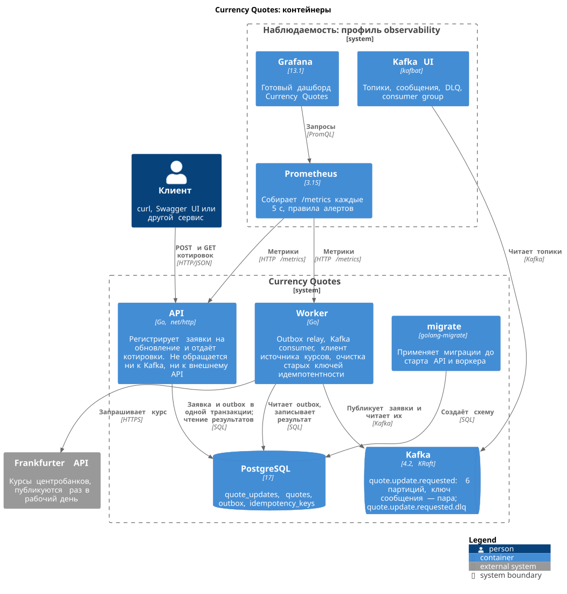
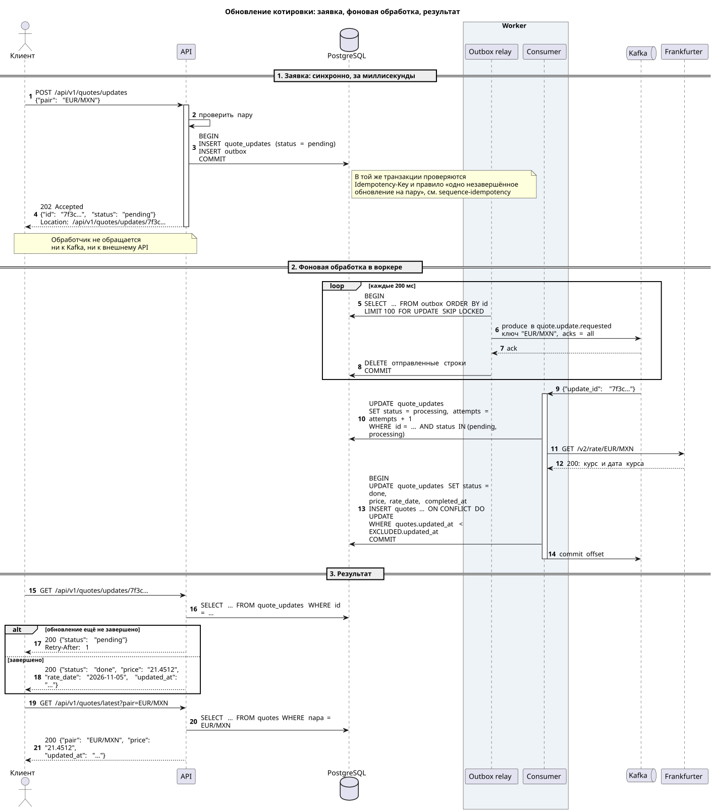

# Currency Quotes

[](https://github.com/DmitryGityuk/currency-quotes/actions/workflows/ci.yml)

Сервис котировок валютных курсов с асинхронным обновлением.

Клиент отправляет запрос на обновление котировки и сразу получает идентификатор. Само обновление выполняется в фоне: запрос через outbox попадает в Kafka, воркер получает курс из [Frankfurter](https://frankfurter.dev) и сохраняет его в PostgreSQL. Затем клиент запрашивает результат по идентификатору или последнюю котировку пары. Поддерживаются валюты USD, EUR и MXN.

Попробовать без установки: [Swagger UI](https://quotes.87-199-194-92.sslip.io/docs) и [дашборд Grafana](https://grafana.quotes.87-199-194-92.sslip.io). Конфигурация этого сервера лежит в [`compose.server.yaml`](compose.server.yaml).

## Запуск

Нужен только Docker с Compose v2.

```sh
docker compose up --build --detach --wait
```

Демо проходит сценарий задания и проверяет каждый шаг:

```sh
docker compose run --rm demo
```

Swagger UI: <http://localhost:8080/docs>

Метрики, алерты и Kafka UI запускаются отдельным профилем:

```sh
docker compose --profile observability up --detach --wait
```

- Grafana с дашбордом: <http://localhost:3000>
- Prometheus: <http://localhost:9090>
- Kafka UI: <http://localhost:8090>

Без доступа в интернет используйте фейковый источник курсов: `RATES_PROVIDER=fake docker compose up --build --detach --wait`.

Остановить и удалить данные: `docker compose --profile observability down --volumes`.

## API

Контракт описан в [`api/openapi.yaml`](api/openapi.yaml).

| Метод и путь | Что делает |
| --- | --- |
| `POST /api/v1/quotes/updates` | Принимает пару и сразу отвечает `202` с `id` обновления |
| `GET /api/v1/quotes/updates/{id}` | Статус обновления, а когда оно завершено — цена и время обновления |
| `GET /api/v1/quotes/latest?pair=EUR/MXN` | Последняя котировка пары |

```sh
curl -X POST http://localhost:8080/api/v1/quotes/updates \
  -H 'Content-Type: application/json' \
  -H 'Idempotency-Key: 5f0c6e9e-2b7a-4c55-9d43-7d3f1a2b8c61' \
  -d '{"pair": "EUR/MXN"}'
# 202 {"id":"01a1b7a3-…","pair":"EUR/MXN","status":"pending","requested_at":"…"}

curl http://localhost:8080/api/v1/quotes/updates/01a1b7a3-…
# 200 {"id":"01a1b7a3-…","status":"done","price":"21.3619","rate_date":"2026-11-07","updated_at":"…",…}

curl 'http://localhost:8080/api/v1/quotes/latest?pair=EUR/MXN'
# 200 {"pair":"EUR/MXN","price":"21.3619","rate_date":"2026-11-07","updated_at":"…","update_id":"01a1b7a3-…"}
```

Повтор с тем же `Idempotency-Key` возвращает тот же `id`. Пока по паре идёт обновление, новые запросы по ней получают его `id`.

## Архитектура



API только регистрирует заявку: одной транзакцией записывает обновление и сообщение в таблицу `outbox` и отвечает `202`. Воркер переносит сообщения из outbox в Kafka, читает их, запрашивает курс и записывает результат.



Ещё диаграммы: [идемпотентность](docs/diagrams/sequence-idempotency.svg), [сбои](docs/diagrams/sequence-failures.svg), [статусы обновления](docs/diagrams/state-update.svg), [схема БД](docs/diagrams/er.svg). Исходники лежат в `docs/diagrams/*.puml`, SVG рисует CI.

## Разработка

Нужен Go 1.27.

```sh
make test              # unit-тесты
make test-integration  # интеграционные тесты на PostgreSQL, нужен make infra
make lint              # golangci-lint
make infra             # PostgreSQL и Kafka в Docker для запуска сервиса с хоста
make run-api           # API на хосте
make run-worker        # воркер на хосте
make help              # остальные команды
```

```text
cmd/quotes/          точка входа: режимы api, worker, demo, healthcheck
internal/httpapi/    HTTP-сервер, обработчики, middleware
internal/worker/     обработка заявок: повторы, failed, DLQ
internal/postgres/   хранилище на pgx
internal/kafka/      consumer и producer на franz-go
internal/outbox/     relay из outbox в Kafka
internal/rates/      клиент Frankfurter и фейковый источник
internal/metrics/    метрики Prometheus
internal/quotes/     доменные типы
api/                 спецификация OpenAPI
migrations/          SQL-миграции
deploy/              Prometheus, алерты, дашборд Grafana
docs/diagrams/       диаграммы PlantUML
```
